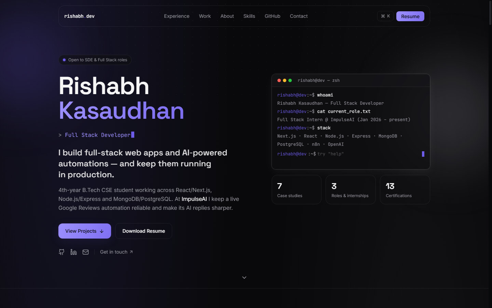

<div align="center">

# Rishabh Kasaudhan — Portfolio

**Full Stack Developer · Next.js · Node.js · MongoDB · AI Automation**

Personal portfolio of a Full Stack Intern at ImpulseAI and final-year B.Tech CSE student.
Built with Next.js 14, TypeScript, Tailwind CSS and Framer Motion.

[](https://nextjs.org/)
[](https://www.typescriptlang.org/)
[](https://tailwindcss.com/)
[](https://www.framer.com/motion/)
[](LICENSE)

**[Live site](https://rishabh-kasaudhan.vercel.app) · [Resume](public/resume.pdf) · [LinkedIn](https://www.linkedin.com/in/rishabh-kasaudhan-0a960724a/) · [GitHub](https://github.com/Rishabh893-ux)**

<br />



</div>

---

## Highlights

- **"Ask my AI" assistant** — a chat that answers visitors' questions about me from the portfolio's own data, with streamed replies from Gemini. The key stays on the server behind an origin check, a per-visitor rate limit and a timeout.
- **3D hero** — a real-time three.js "neural globe" with data arcs and travelling pulses that reacts to the mouse and to scrolling. It falls back to a 2D canvas without WebGL or with reduced motion.
- **Cinematic scrolling** — Lenis smooth scrolling, and on large screens the Work section pins while featured projects slide horizontally.
- **Blog** — MDX posts in `content/blog/` with syntax highlighting for both themes, reading time and an "On this page" table of contents.
- **Light and dark themes** — a violet dark theme and a warm beige-and-gold light theme, with serif display type and a cursor glow.
- **Experience-first layout** — the ImpulseAI internship leads the page, with an animated diagram of the Google Reviews pipeline (Google Business Profile API → n8n → OpenAI → reply + dashboard).
- **Project case studies** — every project has its own page (`/project/[slug]`) with problem, solution, system flow, tech decisions and challenges. Live projects show real screenshots.
- **Interactive terminal** in the hero — try `help`, `experience`, `projects`, `github`, `resume`.
- **`Ctrl/⌘ + K` command palette** for keyboard navigation across the site.
- **Clickable skills** — each technology shows which projects and roles actually used it.
- **Live GitHub repos** pulled client-side from the public GitHub API, with a language breakdown chart.
- **Working contact form** via Formspree, falling back to `mailto:` when not configured.
- **SEO ready** — metadata, generated Open Graph image, `sitemap.xml` and `robots.txt`.
- **Accessible and motion-aware** — keyboard navigable, visible focus states, and animations respect `prefers-reduced-motion`.
- **Responsive** — tested down to 390px phone width.

## Tech stack

| Area | Tools |
| --- | --- |
| Framework | Next.js 14 (App Router), React 18, TypeScript |
| Styling | Tailwind CSS 3.4, Space Grotesk + Inter + JetBrains Mono via `next/font` |
| Animation | Framer Motion 11, Lenis (smooth scrolling) |
| 3D | three.js (loaded on demand) |
| Blog | MDX via `next-mdx-remote`, `rehype-pretty-code` + Shiki, `rehype-slug` |
| AI | Gemini API (streaming), through the `/api/ask` route |
| Logos | `simple-icons` |
| Icons | lucide-react |
| Social image | `next/og` (generated at request time on the Edge runtime) |
| Analytics | Vercel Analytics |
| Forms | Formspree (optional) |

## Getting started

Requires **Node.js 18.17+**.

```bash
git clone https://github.com/Rishabh893-ux/Rishabh-Portfolio.git
cd Rishabh-Portfolio
npm install
npm run dev
```

Open [http://localhost:3000](http://localhost:3000).

| Script | What it does |
| --- | --- |
| `npm run dev` | Start the dev server with hot reload |
| `npm run build` | Create a production build |
| `npm run start` | Serve the production build |
| `npm run lint` | Check the code with ESLint (Next.js rules) |

## Environment variables

All are optional. Copy `.env.example` to `.env.local` for local development.

| Variable | Purpose |
| --- | --- |
| `NEXT_PUBLIC_FORMSPREE_ID` | Formspree form ID (the part after `/f/`). Defaults to this site's own form; set it to use another form, or to an empty value to make the contact form open the visitor's email app instead. |
| `NEXT_PUBLIC_SITE_URL` | Public URL used for metadata, the sitemap and `robots.txt`. On Vercel it's detected automatically, so set this only for a custom domain. |
| `GEMINI_API_KEY` | Turns on the "Ask my AI" chat. Get a free key at [aistudio.google.com/apikey](https://aistudio.google.com/apikey). Server-only; without it the chat shows the contact email instead. |
| `GEMINI_MODEL` | Optional model override for the chat (default `gemini-3.8-flash`). |

## Editing content

All content lives in `data/`, so updating the site rarely means touching components.

| File | Controls |
| --- | --- |
| `data/site.ts` | Name, rotating roles, links, email, education |
| `data/experience.ts` | Internship and leadership roles |
| `data/projects.ts` | Projects, case-study content, GitHub/demo links, screenshots |
| `data/skills.ts` | Skill categories and which projects/roles use each skill |
| `data/certifications.ts` | Certifications (add `link` for a verify button) |
| `public/resume.pdf` | The file behind every "Resume" button |
| `public/projects/` | Project screenshots referenced by `image` in `projects.ts` |
| `content/blog/*.mdx` | Blog posts. Front matter: `title`, `description`, `date` (YYYY-MM-DD) and `tags`. `## ` headings become the table of contents. |

A GitHub or demo link set to `"#"` is hidden automatically, so unfinished links never show as broken buttons.

## Project structure

```
app/
  layout.tsx              Root layout: fonts, metadata, analytics
  page.tsx                Home page — composes the sections
  project/[slug]/         Statically generated case-study pages
  opengraph-image.tsx     Generated social preview image
  sitemap.ts, robots.ts   SEO routes
  globals.css             Base styles and utility classes
components/               Sections (Hero, Experience, ProjectGrid, Skills…) and shared UI
data/                     All site content (see above)
lib/                      Helpers: site URL, chart colors, utilities
public/                   Resume, favicon, project screenshots
docs/                     README assets
```

## Deployment

The site is designed for [Vercel](https://vercel.com):

1. Push this repository to GitHub.
2. Import it at [vercel.com/new](https://vercel.com/new). The defaults for Next.js work as-is.
3. The contact form already sends through Formspree, so no environment variables are needed.
4. To use a custom domain, add it under **Settings → Domains** and set `NEXT_PUBLIC_SITE_URL` to it.

Every push to `main` then deploys automatically.

## License

The **source code** is released under the [MIT License](LICENSE) — feel free to learn from it or use it as a starting point for your own portfolio.

The **personal content** — my resume, bio, experience and project descriptions, and screenshots — is not covered by the license. Please don't republish it as your own.

## Contact

**Rishabh Kasaudhan** — [rkasaudhan87@gmail.com](mailto:rkasaudhan87@gmail.com) · [LinkedIn](https://www.linkedin.com/in/rishabh-kasaudhan-0a960724a/) · [GitHub](https://github.com/Rishabh893-ux)
